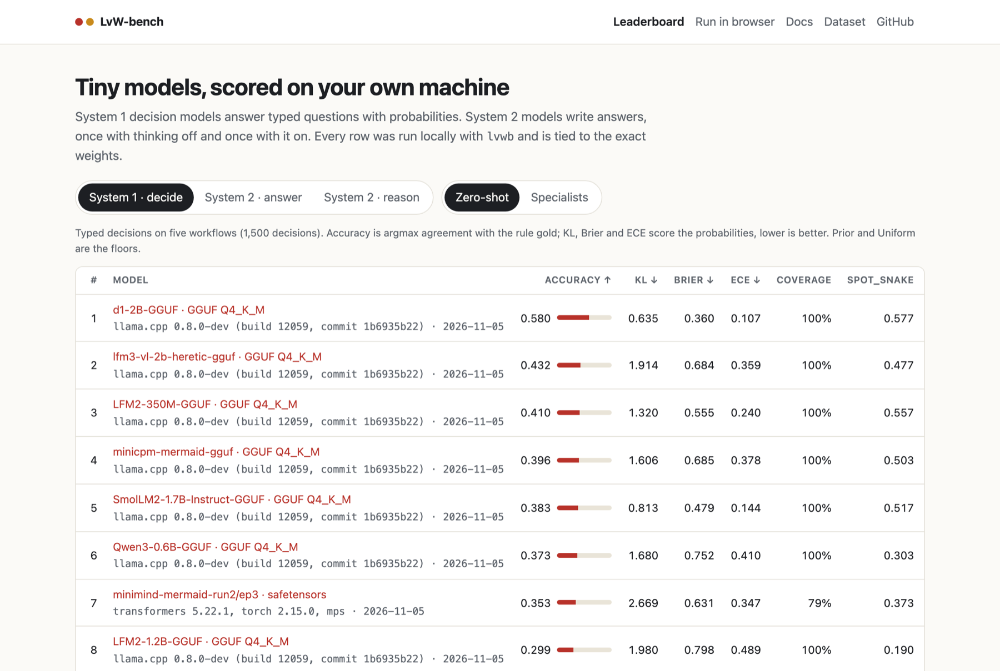
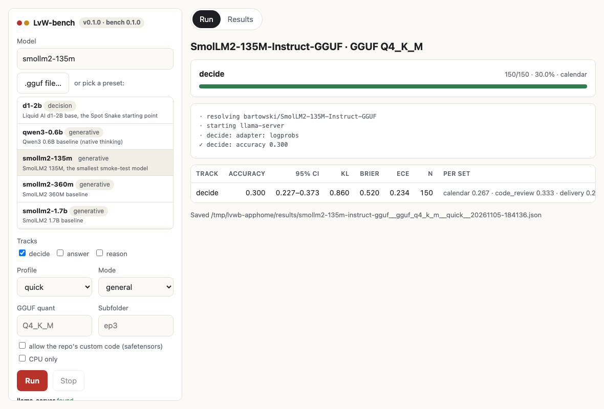

<div align="center">

# LvW-bench

A local benchmark for tiny AI models: System 1 decision models and System 2 generative models,
scored on your own machine.

[Leaderboard](https://gitguy268.github.io/LvW-bench/) ·
[Docs](https://gitguy268.github.io/LvW-bench/docs.html) ·
[Run in browser](https://gitguy268.github.io/LvW-bench/run.html) ·
[Dataset](https://huggingface.co/datasets/Lucasgitguy-co/LvW-bench) ·
[HF Space](https://huggingface.co/spaces/Lucasgitguy-co/LvW-bench-leaderboard) ·
[Install](#install) · [Usage](#usage) · [How it scores](#how-it-scores)

[](https://github.com/Gitguy268/LvW-bench/actions/workflows/ci.yml)
[](https://github.com/Gitguy268/LvW-bench/releases)
[](https://huggingface.co/datasets/Lucasgitguy-co/LvW-bench)
[](LICENSE)



</div>

## What it is

LvW-bench measures small models on three tracks:

| Track | Kind of model | What it asks | Scored on |
|---|---|---|---|
| **decide** | System 1: decision models (d1, Jev-style heads), or any LLM | 5 workflows of typed questions (`choice`, `score`, `noul`), each answered as a probability distribution | accuracy, KL from gold, Brier, ECE |
| **answer** | System 2: generative models | GSM8K, MMLU, MMLU-Pro, TruthfulQA, IFEval and a seeded generated set, thinking off | accuracy (95% CI), tokens, speed |
| **reason** | System 2: generative models | the same sets with thinking on: native `<think>`, or step by step | accuracy, out-of-budget rate |

It takes the same inputs as hosted benches such as TPN: a Hugging Face link or id, a local
**`.gguf`**, a local **`.safetensors`** folder (adapters too), or any OpenAI-compatible server.
Everything runs locally:
- GGUF files run through `llama-server`. Decision models use its native `/v1/systemone`.
- Safetensors run through a small transformers helper that `uv` starts.
- Each result is tied to the repo commit, file, quant and engine build.

There are four ways to run it: the `lvwb` terminal command, a terminal UI, a desktop app for
macOS, Windows and Linux, and a [browser runner](https://gitguy268.github.io/LvW-bench/run.html)
(wllama or WebLLM on WebGPU). The task data and the leaderboard are published as a benchmark
dataset on Hugging Face, in the same layout as
[typed-decisions](https://huggingface.co/datasets/LocalLLaMA/typed-decisions).

## Install

### Install with Homebrew

```bash
brew trust gitguy268/tap                          # once: new Homebrew asks before using a tap
brew install gitguy268/tap/lvw-bench              # the lvwb command (macOS and Linux)
brew install --cask gitguy268/tap/lvw-bench-app   # the desktop app (macOS)
brew install llama.cpp uv                         # engines: GGUF and safetensors
```

### Other ways

| Platform | Terminal | App |
|---|---|---|
| macOS | Homebrew, or `lvwb-*-darwin-*.tar.gz` | Homebrew cask, or `LvW-bench-*-macos-universal.zip` |
| Linux | Homebrew, or `lvwb-*-linux-*.tar.gz` | `io.github.gitguy268.lvw_bench.flatpak`, `lvw-bench-app_*_amd64.deb` or `LvW-bench-*-linux-amd64.tar.gz` |
| Windows | `lvwb-*-windows-*.zip` | `LvW-bench-*-windows-amd64-setup.exe` |

All of these are on the [releases page](https://github.com/Gitguy268/LvW-bench/releases).

The Flatpak installs with `flatpak install --user ./io.github.gitguy268.lvw_bench.flatpak` (add
Flathub as a remote first for the runtime). It includes llama.cpp for GGUF models but not uv. It
is built by this repo, not Flathub; see [packaging/flatpak](packaging/flatpak/README.md).
`SHA256SUMS.txt` lists the checksums.

The release builds are not signed. On macOS, the cask removes the quarantine flag; if you
download the zip yourself, right-click the app and choose Open the first time. On Windows,
SmartScreen asks once.

<details><summary>Build from source</summary>

```bash
git clone https://github.com/Gitguy268/LvW-bench && cd LvW-bench
go build -o lvwb ./cmd/lvwb            # Go 1.23+
./lvwb selftest

# desktop app (Wails v2; Linux needs libgtk-3-dev and libwebkit2gtk-4.1-dev)
go install github.com/wailsapp/wails/v2/cmd/wails@v2.17.1
cd app && wails build                  # add -tags webkit2_41 on Linux
```

</details>

## Usage

```bash
lvwb run Lucasgitguy-co/spot-snake-d1-2B-v0.1           # HF id: picks the GGUF (Q4_K_M), starts llama-server
lvwb run https://huggingface.co/unsloth/Qwen3-0.6B-GGUF  # HF link
lvwb run ~/models/model-Q4_K_M.gguf                      # local GGUF
lvwb run ~/models/my-model/                              # local safetensors folder
lvwb run http://127.0.0.1:8080/v1 --backend openai       # a server you already run
lvwb run qwen3-0.6b --profile quick                      # a preset (lvwb models)
lvwb tui                                                 # pick a preset in the terminal UI
lvwb leaderboard                                         # your saved results, ranked per track
```

| Flag | Meaning |
|---|---|
| `--track decide,answer,reason` | tracks to run (default: every track the model supports) |
| `--profile quick\|standard\|full` | smoke test, the leaderboard set, or everything |
| `--quant`, `--file`, `--format`, `--subfolder`, `--revision` | which weights to use inside a repo |
| `--trust-remote-code` | allow a repo's own model code (safetensors) |
| `--seed N` | a fresh generated set |
| `--mode specialist` | the model was trained on the same task |

Other commands: `lvwb models`, `tasks`, `results`, `compare a.json b.json`,
`export --md|--csv|--eval-results`, `rescore`, `submit`, `selftest`.

<details><summary>The desktop app</summary>

The app is a window over the same runner. Pick a preset or type a model, choose the tracks and
profile, and watch each track's progress. Saved results are in the Results tab. It looks for
`llama-server` and `uv` and says which one is missing.



</details>

## Leaderboard

Bench 0.1.0, `standard` profile, all runs local. The live version with sorting and per-workflow
columns is on the [leaderboard page](https://gitguy268.github.io/LvW-bench/).

<!-- leaderboard:start -->
#### System 1 · decide

| # | Model | Accuracy ↑ | KL ↓ | Brier ↓ | ECE ↓ | Coverage | p50 / case | Adapter |
|---|---|---|---|---|---|---|---|---|
| 1 | [LiquidAI/d1-2B-GGUF](https://huggingface.co/LiquidAI/d1-2B-GGUF) · GGUF Q4_K_M | 0.580 | 0.635 | 0.360 | 0.107 | 100% | 1698 ms | systemone |
| 2 | [Lucasgitguy-co/lfm3-vl-2b-heretic-gguf](https://huggingface.co/Lucasgitguy-co/lfm3-vl-2b-heretic-gguf) · GGUF Q4_K_M | 0.432 | 1.914 | 0.684 | 0.359 | 100% | 3294 ms | logprobs |
| 3 | [LiquidAI/LFM2-350M-GGUF](https://huggingface.co/LiquidAI/LFM2-350M-GGUF) · GGUF Q4_K_M | 0.410 | 1.320 | 0.555 | 0.240 | 100% | 918 ms | logprobs |
| 4 | [Lucasgitguy-co/minicpm-mermaid-gguf](https://huggingface.co/Lucasgitguy-co/minicpm-mermaid-gguf) · GGUF Q4_K_M | 0.396 | 1.606 | 0.685 | 0.378 | 100% | 3424 ms | logprobs |
| 5 | [bartowski/SmolLM2-1.7B-Instruct-GGUF](https://huggingface.co/bartowski/SmolLM2-1.7B-Instruct-GGUF) · GGUF Q4_K_M | 0.383 | 0.813 | 0.479 | 0.144 | 100% | 3183 ms | logprobs |
| 6 | [unsloth/Qwen3-0.6B-GGUF](https://huggingface.co/unsloth/Qwen3-0.6B-GGUF) · GGUF Q4_K_M | 0.373 | 1.680 | 0.752 | 0.410 | 100% | 1494 ms | logprobs |
| 7 | [Lucasgitguy-co/minimind-mermaid-run2](https://huggingface.co/Lucasgitguy-co/minimind-mermaid-run2)/ep3 · safetensors | 0.353 | 2.669 | 0.631 | 0.347 | 79% | 335 ms | logprobs |
| 8 | [LiquidAI/LFM2-1.2B-GGUF](https://huggingface.co/LiquidAI/LFM2-1.2B-GGUF) · GGUF Q4_K_M | 0.299 | 1.980 | 0.798 | 0.489 | 100% | 2286 ms | logprobs |
| 9 | [bartowski/SmolLM2-135M-Instruct-GGUF](https://huggingface.co/bartowski/SmolLM2-135M-Instruct-GGUF) · GGUF Q4_K_M | 0.282 | 0.888 | 0.519 | 0.224 | 100% | 175 ms | logprobs |
| 10 | [bartowski/SmolLM2-360M-Instruct-GGUF](https://huggingface.co/bartowski/SmolLM2-360M-Instruct-GGUF) · GGUF Q4_K_M | 0.271 | 0.909 | 0.505 | 0.203 | 100% | 577 ms | logprobs |
| – | Prior (ignores the input) | 0.482 | 0.631 | 0.373 | 0.022 | – | – | reference |
| – | Uniform (same probability on every option) | 0.331 | 0.709 | 0.429 | 0.105 | – | – | reference |

#### System 1 · decide: specialists

Trained on the same task as a workflow (the Spot Snake models learned `spot_snake` moves with the same teacher), so not comparable with the zero-shot table.

| # | Model | Accuracy ↑ | KL ↓ | Brier ↓ | ECE ↓ | Coverage | p50 / case | Adapter |
|---|---|---|---|---|---|---|---|---|
| 1 | [Lucasgitguy-co/spot-snake-d1-3B-v0.1](https://huggingface.co/Lucasgitguy-co/spot-snake-d1-3B-v0.1) · GGUF Q4_K_M | 0.563 | 2.372 | 0.487 | 0.272 | 100% | 2172 ms | systemone |
| 2 | [Lucasgitguy-co/spot-snake-d1-2B-v0.1](https://huggingface.co/Lucasgitguy-co/spot-snake-d1-2B-v0.1) · GGUF Q4_K_M | 0.535 | 1.722 | 0.565 | 0.329 | 100% | 1564 ms | systemone |
| 3 | [Lucasgitguy-co/spot-snake-minimind-jev-v0.1](https://huggingface.co/Lucasgitguy-co/spot-snake-minimind-jev-v0.1) · safetensors | 0.334 | 0.709 | 0.429 | 0.102 | 7% | 0 ms | systemone |

#### System 2 · answer

| # | Model | Accuracy ↑ | 95% CI | gsm8k | mmlu | mmlu_pro | truthfulqa | ifeval | generated | tok/answer | tok/s |
|---|---|---|---|---|---|---|---|---|---|---|---|
| 1 | [Lucasgitguy-co/minicpm-mermaid-gguf](https://huggingface.co/Lucasgitguy-co/minicpm-mermaid-gguf) · GGUF Q4_K_M | 0.396 | 0.368–0.425 | 0.080 | 0.535 | 0.186 | 0.360 | 0.710 | 0.413 | 27 | 57 |
| 2 | [LiquidAI/LFM2-1.2B-GGUF](https://huggingface.co/LiquidAI/LFM2-1.2B-GGUF) · GGUF Q4_K_M | 0.385 | 0.355–0.413 | 0.010 | 0.504 | 0.150 | 0.333 | 0.755 | 0.449 | 74 | 159 |
| 3 | [Lucasgitguy-co/lfm3-vl-2b-heretic-gguf](https://huggingface.co/Lucasgitguy-co/lfm3-vl-2b-heretic-gguf) · GGUF Q4_K_M | 0.382 | 0.355–0.410 | 0.045 | 0.408 | 0.186 | 0.360 | 0.735 | 0.480 | 54 | 91 |
| 4 | [bartowski/SmolLM2-1.7B-Instruct-GGUF](https://huggingface.co/bartowski/SmolLM2-1.7B-Instruct-GGUF) · GGUF Q4_K_M | 0.305 | 0.279–0.333 | 0.030 | 0.548 | 0.171 | 0.213 | 0.530 | 0.249 | 64 | 82 |
| 5 | [unsloth/Qwen3-0.6B-GGUF](https://huggingface.co/unsloth/Qwen3-0.6B-GGUF) · GGUF Q4_K_M | 0.298 | 0.273–0.326 | 0.025 | 0.386 | 0.136 | 0.320 | 0.605 | 0.267 | 57 | 129 |
| 6 | [LiquidAI/LFM2-350M-GGUF](https://huggingface.co/LiquidAI/LFM2-350M-GGUF) · GGUF Q4_K_M | 0.269 | 0.241–0.293 | 0.020 | 0.447 | 0.121 | 0.220 | 0.565 | 0.169 | 89 | 346 |
| 7 | [bartowski/SmolLM2-360M-Instruct-GGUF](https://huggingface.co/bartowski/SmolLM2-360M-Instruct-GGUF) · GGUF Q4_K_M | 0.212 | 0.187–0.236 | 0.045 | 0.259 | 0.136 | 0.207 | 0.390 | 0.204 | 82 | 233 |
| 8 | [bartowski/SmolLM2-135M-Instruct-GGUF](https://huggingface.co/bartowski/SmolLM2-135M-Instruct-GGUF) · GGUF Q4_K_M | 0.158 | 0.137–0.181 | 0.015 | 0.228 | 0.100 | 0.213 | 0.225 | 0.156 | 110 | 749 |
| 9 | [Lucasgitguy-co/minimind-mermaid-run2](https://huggingface.co/Lucasgitguy-co/minimind-mermaid-run2)/ep3 · safetensors | 0.029 | 0.019–0.039 | 0.010 | 0.009 | 0.007 | 0.000 | 0.105 | 0.031 | 193 | 399 |

#### System 2 · reason

| # | Model | Accuracy ↑ | 95% CI | gsm8k | mmlu | mmlu_pro | truthfulqa | ifeval | generated | tok/answer | tok/s |
|---|---|---|---|---|---|---|---|---|---|---|---|
| 1 | [LiquidAI/LFM2-1.2B-GGUF](https://huggingface.co/LiquidAI/LFM2-1.2B-GGUF) · GGUF Q4_K_M | 0.517 | 0.450–0.579 | 0.600 | 0.500 | 0.300 | 0.375 | 0.750 | 0.575 | 461 | 206 |
| 2 | [Lucasgitguy-co/lfm3-vl-2b-heretic-gguf](https://huggingface.co/Lucasgitguy-co/lfm3-vl-2b-heretic-gguf) · GGUF Q4_K_M | 0.508 | 0.450–0.571 | 0.700 | 0.500 | 0.250 | 0.375 | 0.450 | 0.775 | 1477 | 140 |
| 3 | [Lucasgitguy-co/minicpm-mermaid-gguf](https://huggingface.co/Lucasgitguy-co/minicpm-mermaid-gguf) · GGUF Q4_K_M | 0.404 | 0.338–0.463 | 0.100 | 0.475 | 0.350 | 0.425 | 0.650 | 0.425 | 488 | 168 |
| 4 | [bartowski/SmolLM2-1.7B-Instruct-GGUF](https://huggingface.co/bartowski/SmolLM2-1.7B-Instruct-GGUF) · GGUF Q4_K_M | 0.379 | 0.317–0.442 | 0.400 | 0.500 | 0.275 | 0.200 | 0.425 | 0.475 | 316 | 103 |
| 5 | [LiquidAI/LFM2-350M-GGUF](https://huggingface.co/LiquidAI/LFM2-350M-GGUF) · GGUF Q4_K_M | 0.317 | 0.258–0.375 | 0.425 | 0.400 | 0.200 | 0.125 | 0.500 | 0.250 | 350 | 502 |
| 6 | [unsloth/Qwen3-0.6B-GGUF](https://huggingface.co/unsloth/Qwen3-0.6B-GGUF) · GGUF Q4_K_M | 0.312 | 0.254–0.371 | 0.650 | 0.075 | 0.025 | 0.025 | 0.650 | 0.450 | 924 | 187 |
| 7 | [bartowski/SmolLM2-135M-Instruct-GGUF](https://huggingface.co/bartowski/SmolLM2-135M-Instruct-GGUF) · GGUF Q4_K_M | 0.146 | 0.104–0.192 | 0.025 | 0.150 | 0.225 | 0.150 | 0.225 | 0.100 | 954 | 603 |
| 8 | [bartowski/SmolLM2-360M-Instruct-GGUF](https://huggingface.co/bartowski/SmolLM2-360M-Instruct-GGUF) · GGUF Q4_K_M | 0.129 | 0.087–0.171 | 0.075 | 0.075 | 0.100 | 0.050 | 0.250 | 0.225 | 507 | 203 |
| 9 | [Lucasgitguy-co/minimind-mermaid-run2](https://huggingface.co/Lucasgitguy-co/minimind-mermaid-run2)/ep3 · safetensors | 0.033 | 0.013–0.058 | 0.000 | 0.000 | 0.000 | 0.000 | 0.175 | 0.025 | 2202 | 370 |

Among zero-shot models only d1-2B beats the Prior row on System 1 accuracy: the text models answer typed decisions through one token and are poorly calibrated (the two Spot Snake d1 specialists also beat it). The Spot Snake fine-tunes gain on `spot_snake` but lose on the other four workflows.
<!-- leaderboard:end -->

## How it scores

<details><summary>System 1: decide</summary>

There are five original workflows: `spot_snake`, `it_support`, `delivery`, `code_review` and
`calendar`. Each case has a state and three typed questions. The gold distribution comes from
fixed rules, with no teacher model:
- A fact the state shows directly gets a sharp gold.
- A judgement call keeps a soft gold.

`spot_snake` uses the Spot's Biscuit Snake game's own text and the teacher from
[spot-snake-decisions](https://huggingface.co/datasets/Lucasgitguy-co/spot-snake-decisions-v0.1).

How models answer:
- **Decision models** answer the whole case through `/v1/systemone`.
- **Text models** answer each question through the probabilities of their first output token.
  When a server gives no logprobs, the bench samples 8 answers instead.

Scoring follows typed-decisions' scorer: argmax accuracy, KL(gold‖pred), Brier and 10-bin ECE.
Models trained on the same task are listed as **specialists**, apart from the zero-shot table.

</details>

<details><summary>System 2: answer and reason</summary>

The bench uses permissive subsets only: GSM8K, MMLU and MMLU-Pro (MIT), and TruthfulQA and
IFEval (Apache-2.0). ARC is CC-BY-SA, so it is left out. There is also a generated set of 225
items: arithmetic, word problems, letter counts, sorting, dates, syllogisms, list lookups, JSON
and Mermaid. Every generated answer is computed, so `--seed` gives fresh items.

Scoring:
- The scorer removes `<think>` blocks, then reads the `Answer:` line, the leading letter or the
  last number.
- A think block that never closes is out of budget and counts as wrong.
- IFEval uses strict prompt-level accuracy on 17 verifiable instruction types.

These are generated-answer scores, so they are **not comparable with lm-eval loglikelihood
numbers** (for example TPN's ARC `acc_norm`).

</details>

<details><summary>Reproducing a score</summary>

Every result has a `.predictions.jsonl` next to it. `lvwb rescore` (Go) or `bench/score.py`
(Python) recomputes the score without the model. The Go, Python and browser scorers share
`internal/score/golden.json`, and CI fails if any of them disagree.

</details>

## Repository

| Path | What is there |
|---|---|
| `cmd/lvwb` | CLI and TUI |
| `internal/` | tasks, scorers, model resolver, HF downloads, backends, runner |
| `helper/` | the Python safetensors server (embedded in `lvwb`, run with uv) |
| `app/` | Wails desktop app |
| `web/` | GitHub Pages: leaderboard, docs, browser runner |
| `dataset/` | builds the Hugging Face dataset and the Space |
| `bench/` | Python scorer shipped with the dataset |
| `results/` | the seed leaderboard results |

## Contributing

See [CONTRIBUTING.md](CONTRIBUTING.md). Results go to the dataset's
[discussions](https://huggingface.co/datasets/Lucasgitguy-co/LvW-bench/discussions) or as a PR
that adds files to `results/`.

## Licence

MIT, © Lucas Van De Weerd. The rows from GSM8K, MMLU and MMLU-Pro stay MIT, and the rows from
TruthfulQA and IFEval stay Apache-2.0. The scorer ports and every credit are in
[NOTICE](NOTICE). Models keep their own licences. LvW-bench is not affiliated with TPN,
TypeSafe, LocalLLaMA, Liquid AI or Hugging Face.
